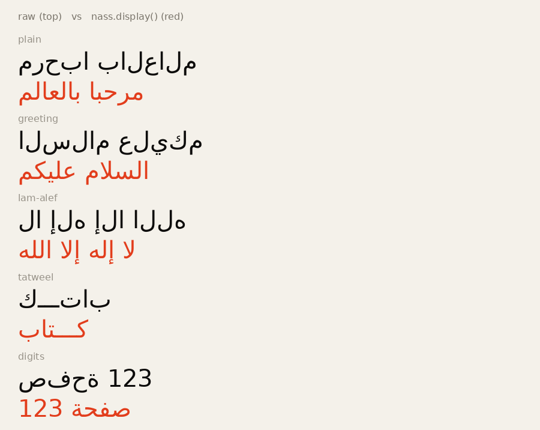

# nass · نص

**Arabic text, handled correctly, everywhere Python touches it.**

[](https://github.com/pyXploit/nass/actions/workflows/ci.yml)
[](https://pypi.org/project/nass/)
[](LICENSE)

[العربية](README.ar.md)

Python's standard library treats Arabic as a sequence of code points. That is
correct and almost never what you want: the same word has several spellings,
numbers have six plural categories, and a renderer that does not shape letters
turns your text into disconnected shapes in the wrong order.

`nass` is the layer between those two facts. Every function takes Arabic text
and returns Arabic text — no objects, no configuration, no surprises.

```bash
pip install git+https://github.com/pyXploit/nass
```

Not on PyPI yet — that lands with the `0.2.0` release.

## What it does

```python
import nass

nass.normalize("أَحْمَد")      # 'احمد'          search and comparison
nass.words(1234)              # 'ألف ومئتان وأربعة وثلاثون'
nass.count(3, "كتاب", plural="كتب")   # '٣ كتب'
nass.ordinal(21)              # 'الحادي والعشرون'
nass.plural_category(11)      # 'many'
nass.to_arabic_digits("2026") # '٢٠٢٦'
nass.shape("بب")              # '\ufe91\ufe90'  initial + final
nass.display("بب")            # '\ufe90\ufe91'  shaped, then reordered
nass.wrap(text, 320, measure=font.getlength)   # list[str]
nass.speak("الساعة 12:30")    # 'الساعة الثانية عشرة والنصف'
```

## Why the plural categories matter

Arabic does not have singular and plural. It has six categories, and the noun
changes shape for each one:

| n | Category | Form |
|---|---|---|
| 0 | `zero` | صفر كتاب |
| 1 | `one` | كتاب |
| 2 | `two` | كتابان |
| 3–10 | `few` | ٣ كتب |
| 11–99 | `many` | ١١ كتابًا |
| 100+ | `other` | ١٠٠ كتاب |

`nass.count()` applies those rules for you. Supply the forms you have;
anything you leave out falls back to the singular.

## Normalisation

Arabic search fails because one word has many spellings. `normalize()` folds
them together:

| Input | Output | Rule |
|---|---|---|
| `أحمد` | `احمد` | alef variants |
| `مدرسة` | `مدرسه` | teh marbuta |
| `مصطفى` | `مصطفي` | alef maqsura |
| `كـتـاب` | `كتاب` | tatweel |
| `مُحَمَّد` | `محمد` | diacritics |
| `١٢٣` | `123` | Arabic-Indic digits |

Every rule can be switched off when the original orthography has to survive:

```python
nass.normalize("مُحَمَّد", strip_diacritics=False)  # 'مُحَمَّد'
```

## Shaping



Arabic letters change shape depending on their neighbours. A renderer that
draws one glyph per code point — PIL with `layout_engine=BASIC`, most PDF
libraries — shows them disconnected and in the wrong order.

```python
nass.shape("بب")    # '\ufe91\ufe90'  initial + final
nass.display("بب")  # '\ufe90\ufe91'  shaped, then reordered
```

`shape()` keeps logical order, for renderers that already handle bidi.
`display()` also reorders, for the ones that do not.

> **Check your renderer first.** Browsers, most modern toolkits, PIL built with
> Raqm, and matplotlib 3.11+ already shape and reorder. Use `display()` only
> with renderers that do neither. Applying it to text that is already shaped
> will double-process it.

The presentation-form tables are derived from Unicode's own decomposition data
at import time, so there is no hand-maintained mapping to drift out of date.
Lam-alef ligatures are handled, and diacritics do not break a join.

## Wrapping

```python
nass.wrap(text, 320, measure=font.getlength)
```

`measure` maps a string to its rendered width — pass your renderer's own.
It defaults to `len`, which is only right for monospaced output.

Arabic punctuation is kept with the word it follows, so a line never begins
with `،` or `؛`, and an opening bracket never ends one.

## Speech

Screen readers and TTS engines read Arabic digits, times and dates badly.
`speak()` rewrites them into the words a person would say.

```python
nass.speak("الساعة 12:30")   # 'الساعة الثانية عشرة والنصف'
nass.speak("50%")            # 'خمسون بالمئة'
nass.speak("3/4/2026")       # 'الثالث من نيسان عام ألفان وستة وعشرون'
nass.speak("3/4/2026", months="egyptian")   # 'الثالث من أبريل ...'
```

Month names default to Levantine; `months="egyptian"` switches to يناير، فبراير.

Two of something becomes the dual, because Arabic does not write the numeral
with a dual noun: `2 قلم` → `قلمان`, `2 سيارة` → `سيارتان`. The rule is regular
(ـان, or تان after ة). Broken plurals and irregular nouns need `count()` with
explicit forms.

## matplotlib

matplotlib 3.11 added HarfBuzz text layout, so Arabic renders correctly with no
help. On older versions:

```python
import nass
nass.plot.enable()   # False on 3.11+, True when it actually patched
```

`enable()` checks the installed version and does nothing when patching would
break things.

## API

| Function | Purpose |
|---|---|
| `normalize(text, **rules)` | Fold to a canonical form for comparison |
| `remove_diacritics(text)` | Drop every combining mark |
| `is_arabic(text, threshold=0.5)` | Is this mostly Arabic? |
| `collapse_whitespace(text)` | One space, trimmed |
| `words(n)` | Spell an integer in Arabic |
| `count(n, noun, **forms)` | Number plus correctly inflected noun |
| `ordinal(n)` | 1–99 as an ordinal word |
| `plural_category(n)` | CLDR category: zero, one, two, few, many, other |
| `to_arabic_digits(text)` | `2026` → `٢٠٢٦` |
| `to_western_digits(text)` | `٢٠٢٦` → `2026` |
| `shape(text)` | Presentation forms, logical order |
| `display(text)` | Shaped and reordered for a left-to-right renderer |
| `wrap(text, width, measure=...)` | Break into lines that respect Arabic punctuation |
| `speak(text, months=...)` | Numbers, times, dates and percentages as spoken Arabic |
| `plot.enable()` | Patch matplotlib < 3.11; no-op on newer |

## Status

`0.3.0` ships normalisation, numbers, shaping, wrapping and speech. The API is
stable; further work is bug fixes and more month-name sets.

## Development

```bash
pip install -e ".[dev]"
ruff check .
mypy
pytest
```

Tests are table-driven: the rules are the test data, so a wrong rule fails
loudly instead of quietly.

## License

MIT
